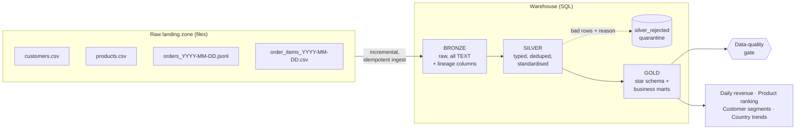

# E-commerce Data Pipeline (Bronze → Silver → Gold)

An end-to-end **batch ELT pipeline** that ingests messy e-commerce source files, cleans and models them
into a **star schema**, enforces **data-quality gates**, and publishes **analytics-ready marts**.

Pure Python standard library + SQL, so it runs anywhere with **zero installs**:

```bash
make all        # generate data -> run pipeline -> print insights
make test       # 13 tests
```

## Architecture



| Layer | Purpose | Tables |
|---|---|---|
| **Bronze** | Exact copy of the source + `_source_file`, `_ingested_at` | `bronze_*` |
| **Silver** | Cleaned, typed, de-duplicated, validated | `silver_*`, `silver_rejected` |
| **Gold** | Star schema + marts for BI | `gold_dim_*`, `gold_fact_sales`, `gold_mart_*` |
| **Ops** | Pipeline metadata | `ops_load_log`, `ops_dq_results` |

## What makes it "real" (not a tutorial copy)

| Real-world problem | How it's handled | Where |
|---|---|---|
| Files get re-delivered / pipeline re-run | **Idempotent** loads tracked by SHA-256 in `ops_load_log` | `pipeline/ingest.py` |
| New day of data arrives | **Incremental**: only new/changed files are read | `pipeline/ingest.py` |
| Crash mid-load | Rows + log entry committed in **one transaction** | `pipeline/ingest.py` |
| One corrupt JSON line | Counted in `bad_lines`, file still loads | `pipeline/ingest.py` |
| Duplicate orders / order lines | `ROW_NUMBER()` window de-duplication | `sql/silver/` |
| `"india"`, `"IN "`, `"U.K."` | Standardised via a **seed/reference table** | `seeds/country_map.csv` |
| Customer details change over time | Latest record wins (SCD-1) | `sql/silver/01_customers.sql` |
| Invalid / orphan records | **Quarantined with a reason**, never silently dropped | `sql/silver/05_rejected.sql` |
| Bad data reaching dashboards | 16 SQL **quality checks**; error-level failures exit non-zero | `pipeline/quality.py` |
| "Do the numbers add up?" | **Reconciliation** checks between layers | `pipeline/quality.py` |
| Refactoring breaks logic | **Golden-dataset tests** with hand-computed expectations | `tests/` |

## Quick start

```bash
git clone <your-repo-url> && cd ecommerce-data-pipeline
python3 -m pipeline generate --days 30     # create messy sample data in data/raw
python3 -m pipeline run                    # ingest -> transform -> quality checks
python3 -m pipeline report                 # business insights
python3 -m unittest discover -s tests -v   # tests
```

Individual stages: `python3 -m pipeline ingest | transform | quality`.

Try the incremental behaviour:

```bash
python3 -m pipeline generate --days 35    # 5 more days land
python3 -m pipeline ingest                # loads ONLY the 10 new files
python3 -m pipeline ingest                # loads 0 files (idempotent)
```

## Sample results (30 days, default seed)

* 62 files / 27,162 raw rows ingested in under a second
* 7,256 valid orders, 17,865 order lines, 926 rejected records (each with a reason)
* All 16 quality checks pass; the test-suite proves they **fail** when data is corrupted

```
Rejected records by reason
  order_items | order_missing_or_rejected | 412
  order_items | invalid_price             | 186
  order_items | invalid_quantity          | 177
  orders      | invalid_order_ts          |  76
  orders      | unknown_customer          |  75
```

## Data model (gold)

```
gold_dim_customer ─┐
gold_dim_product  ─┼─< gold_fact_sales >── gold_dim_date
                   │    (grain: one row per order line)
                   └─ marts: daily_revenue · product_performance ·
                             customer_value (RFM/quartiles) · revenue_by_country_month
```

SQL techniques used: CTEs, window functions (`ROW_NUMBER`, `RANK`, `NTILE`, `LAG`, moving `AVG`),
recursive CTE (calendar dimension), anti-joins, surrogate keys, unique indexes.

Example business questions the marts answer:

```sql
-- Which customers are VIP and when did they last buy?
SELECT customer_id, country, orders, revenue, days_since_last_order
FROM gold_mart_customer_value WHERE segment = 'VIP' ORDER BY revenue DESC LIMIT 10;

-- Best product in every category
SELECT category, product_name, revenue FROM gold_mart_product_performance WHERE rank_in_category = 1;
```

## Project layout

```
pipeline/        Python: generate_data, ingest, transform, quality, cli
sql/silver|gold/ Numbered SQL transformations (like dbt models)
seeds/           Reference data (country mapping)
tests/           Golden-dataset + behaviour tests
dags/            Airflow DAG (written, not run - see note inside)
.github/         CI: tests + end-to-end run on every push
docs/            Resume bullets, interview prep, roadmap
```

## Design decisions & trade-offs

* **SQLite as the warehouse** keeps the project installable anywhere. The SQL is intentionally standard
  (CTEs/window functions) so it ports to **DuckDB, PostgreSQL, BigQuery or Snowflake** with small syntax changes
  (`QUALIFY`, `TRY_CAST`, schemas instead of `bronze_` prefixes). See `docs/ROADMAP.md`.
* **Silver/gold are fully rebuilt each run** (simple and correct at this size). At scale you'd make them
  incremental (merge/upsert by partition) - this is discussed in the interview guide.
* **Quality checks are plain SQL** returning violation counts, so adding one takes a few lines.

## License

MIT - use freely in your portfolio.
